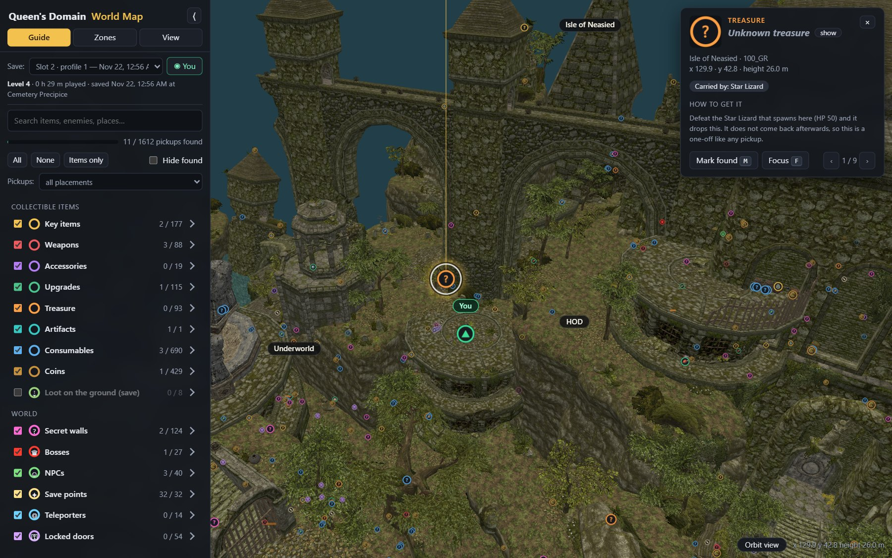

# Queen's Domain Map

A 3D map of the whole world of Queen's Domain, right in your browser. Fly around, find every secret, and let your save
file tick off what you've already got.

**Spoiler-free if you want it:** item names stay hidden until you've found them yourself.

## Get started

You need Windows 10 or 11 and the game installed.

1. Grab the zip from the [latest release](https://github.com/SonOfSaris/queens-domain-map/releases/latest) and unpack
   it into its own folder.
2. Run `QueensDomainMap.exe`. Windows may warn you because the program isn't signed: click *More info*, then
   *Run anyway*.
3. The map opens in your browser and builds itself from your copy of the game. That happens once and takes about a
   minute and 600 MB of disk space.

## What you get

- Every pickup, secret wall, boss, NPC, save point, teleporter, locked door and inscription
- Your save loaded automatically, so only what's left stays on the map
- First-person view and controller support
- A gear stats page that compares every weapon and accessory

## Good to know

- Everything stays on your PC, and your saves are only ever read, never changed.
- No game content is in this download. The map is made from your own copy of the game, so please don't share the
  `data` folder it creates.
- After a game update, the map offers to rebuild itself.

Want the details? Controls, save handling, known limits and developer notes are in the [full guide](docs/GUIDE.md).

---

Fan-made and unofficial; not affiliated with the game's developers or publisher. [MIT licence](LICENSE). Built with
[CUE4Parse](https://github.com/FabianFG/CUE4Parse) and [three.js](https://threejs.org).
